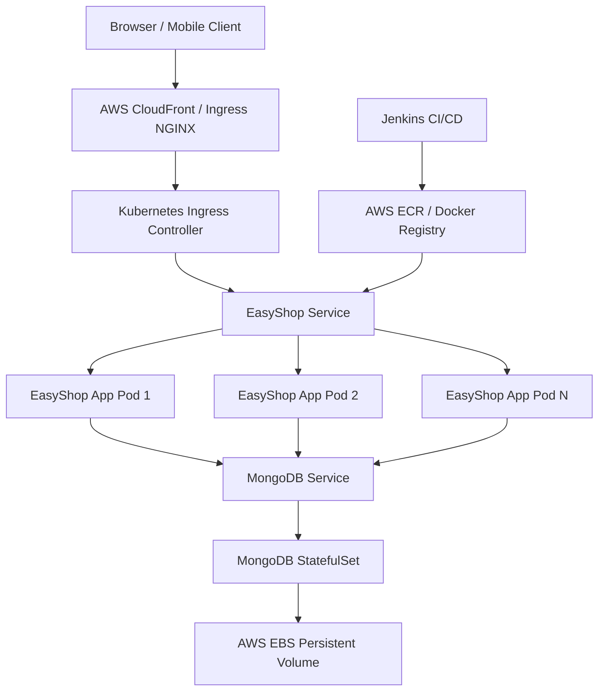

# System Architecture & Design

## Overview
EasyShop is an enterprise-grade cloud-native e-commerce system architected using Next.js 14, containerized with Docker, deployed on AWS EKS Kubernetes cluster, and provisioned via Terraform.

## Core Layers
1. **Frontend**: Next.js App Router, Tailwind CSS, Redux Toolkit.
2. **Backend**: Next.js Route Handlers, Mongoose ODM, JWT verification.
3. **Data Storage**: MongoDB with persistent storage volume claims.
4. **DevOps & Infrastructure**: Docker multi-stage images, AWS EKS, Terraform IaC, Jenkins automated deployment.
