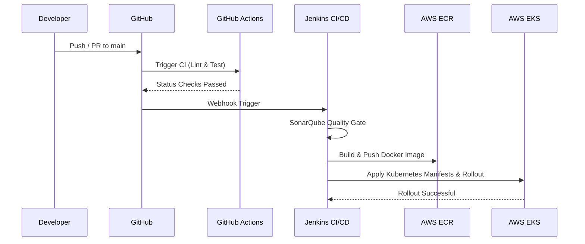

# CI/CD Pipeline Architecture & Operations

## Overview
EasyShop uses a robust CI/CD workflow combining GitHub Actions for code validation and Jenkins for continuous delivery into AWS EKS.

## Jenkins Pipeline Stages
1. **Source Checkout**: Clones the specified commit hash.
2. **SonarQube Analysis**: Performs static security & code smell testing.
3. **Docker Build & Tag**: Packages production multi-stage Next.js image.
4. **Trivy Image Scan**: Ensures zero critical CVE vulnerabilities.
5. **ECR Push**: Stores the image in the Amazon ECR registry.
6. **Kubernetes Rollout**: Runs `kubectl set image` with zero downtime.
